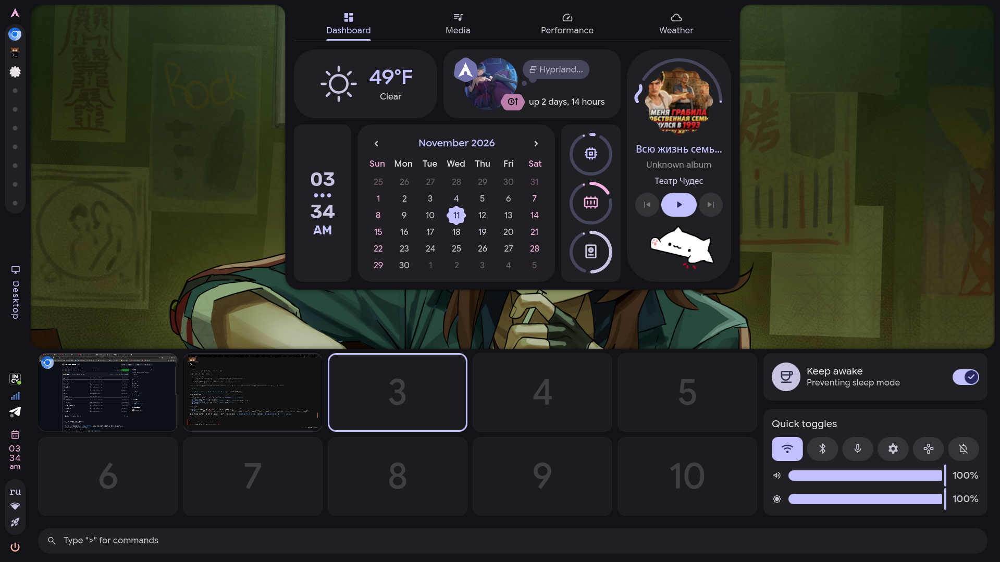

<h1>
   Caelestia Storm
</h1>

A personal rice built on top of [caelestia-dots/shell](https://github.com/caelestia-dots/shell) —
a fork of the Quickshell config with a reworked taskbar (left **or** top), a workspace overview
and a few quality-of-life patches.



Everything that differs from upstream is documented in [`LOCAL-CHANGES.md`](./LOCAL-CHANGES.md).

## What's changed

**Bar (left panel by default)**
- one cell per workspace, with the real app icon (from the `.desktop` entry) instead of a dot;
- the focused window gets a glow that follows the icon's silhouette (`MultiEffect` shadow);
- the status block shows the current keyboard layout (`us`/`ru`), a microphone mute toggle, the
  network icon (a `vpn_lock` globe while the traffic goes through a tunnel) and a power button;
- the bar can sit on the **left or top** (the code supports right/bottom too, they are just not
  exposed in the UI) — Settings → Taskbar → Position. Switching happens **live**: the bar
  re-lays itself out in place, no shell restart;
- on a horizontal bar the workspace pill, tray, clock, status icons and pop-outs all switch to a
  horizontal layout, and the screen's reserved area moves to the bar's edge (windows are pushed
  down instead of right);
- clicking the **clock** toggles 24h/12h, clicking the **mic** mutes it;
- clicking the status icons / active window / tray opens a pop-out anchored under (horizontal)
  or beside (vertical) the entry it belongs to;
- `Alt+J` hides/shows the whole taskbar.

**Super / launcher**
- the stock caelestia search, with a 2×5 workspace grid above it:
  - live window previews (`ScreencopyView`), drag a window onto another workspace to move it;
  - arrow keys move the selection (`↑/↓` by rows, `←/→` by one), `Enter` jumps to the workspace
    (or focuses its window), the scroll wheel pages through workspace groups;
- on the right: a compact *Keep awake* card and *Quick toggles*, where the volume and
  brightness sliders live (click the speaker icon to mute — volume drops to 0 % and back);
- the stock volume/brightness OSD is disabled — everything happens in the launcher;
- the search falls back to a plain substring match when the C++ searcher returns nothing,
  `Enter` launches the highlighted app, and the panel content is pre-built so opening is instant;
- the dashboard (Dashboard / Media / Performance / Weather / **Notifications**) expands only
  together with the launcher; the notifications tab has its own cards, a counter, clear-all
  and an auto-sized pane (plain-text excerpts, max 30 entries — cheap to render);
- clicking the weather card (dashboard or Weather tab) switches **°F** ↔ **°C**.

**Clipboard (`Super+V`)**
- a standalone panel (no search bar, no dashboard) with the `cliphist` history;
- text entries and real image thumbnails, uniform rows with a hover highlight;
- click or `Enter` copies the entry, `✕` deletes one, `delete_sweep` wipes the history.

**Plugins**
- web views are render-only: the page is captured with headless Chromium and refreshed every minute
  (QtWebEngine cannot be embedded in this Quickshell build), so a chromium binary must be installed;
- Settings → **Plugins** lists executables from `~/.config/caelestia/plugins` (and
  `~/.local/share/caelestia/plugins`), each with an on/off switch;
- a plugin is any executable answering JSON commands: `info`, `schemes`, `actions` + `run <id>`,
  `widgets` (live values in the taskbar, refreshed every minute, each clickable via
  `run click <id>`) and
  `window` + `event <id> <json>` (the shell renders the plugin's own window — sections, toggles,
  sliders, choices, text fields, buttons, embedded web pages — and forwards every change back),
  `desktop` (cards drawn on the wallpaper, anchored to a corner or positioned by x/y); drop an
  `icon.png` next to it and the card shows it;
- a plugin scheme only has to name a **seed colour** — the shell expands it into the full Material
  palette and applies it system-wide (terminal, GTK, Qt, btop, …), same as `caelestia scheme set`;
- enabled plugin schemes appear in **Wallpaper & style → Colours → Plugin schemes**;
- **import** installs a `.stormpack` (a zip with a custom extension) through a file picker, and a
  trash button removes a plugin after an inline confirmation
  (`scripts/plugin-pack.py` can still pack plugins from the command line);
- a working Rust example with the protocol lives in [`examples/rust-plugin`](./examples/rust-plugin).

**Other**
- Panels → *Open by dragging* — hold and drag from the top or bottom screen edge to reveal the
  dashboard / launcher (can be turned off, the edges then stay fully clickable);
- *Keep awake* survives shell restarts (`~/.local/state/caelestia/idle-inhibited`);
- Nexus → About: “Caelestia Storm”, custom logo, `v2.5.0 | STORM 1.3`;
- Wallpaper & style → **Colours**: pick a colour scheme (`dynamic` from the wallpaper or any bundled
  one), its flavour and palette variant, or roll a random scheme;
- the bar logo is the Arch mark, wallpaper is drawn by the shell.

## Install

Requires `caelestia-shell` 2.5.0 from the AUR (or a compatible version) and `quickshell-git`.

**Quick install**

```sh
curl -fsSL https://raw.githubusercontent.com/0xcds4r/caelestia-storm/main/install.sh | bash
```

The script checks dependencies, backs up the existing config
(`~/.local/state/caelestia-storm/backups/`), clones/updates the shell config, installs
`shell.json` and restarts the shell. Options: `-f` overwrite `shell.json`, `-n` don't restart.

Or from a checkout:

```sh
git clone https://github.com/0xcds4r/caelestia-storm.git
cd caelestia-storm
./install.sh
```

**Manual install**

```sh
git clone https://github.com/0xcds4r/caelestia-storm.git ~/.config/quickshell/caelestia
mkdir -p ~/.config/caelestia
cp ~/.config/quickshell/caelestia/extra/caelestia-shell.json ~/.config/caelestia/shell.json
caelestia shell -r -d
```

`extra/caelestia-shell.json` is the shell config (volume/brightness inside Quick toggles,
10 workspaces, `osd.enabled: false`, etc.).

**Hyprland keybinds.** The rice expects a few binds; add them to your Hyprland config if they
differ. For the lua-style config used by caelestia/end-4:

```lua
hl.bind("SUPER + SUPER_L", hl.dsp.global("caelestia:launcher"), { release = true }) -- launcher + overview
hl.bind("SUPER + V", hl.dsp.global("caelestia:clipboard"))                          -- clipboard panel
hl.bind("SUPER + R", hl.dsp.exec_cmd("caelestia shell -r -d"))                       -- restart the shell
```

For a plain `hyprland.conf`:

```
bind  = SUPER, V, global, caelestia:clipboard
bind  = SUPER, R, exec, caelestia shell -r -d
```

## Updating from upstream

The fork fully shadows the packaged config in `/etc/xdg/quickshell/caelestia`.
After updating `caelestia-shell` you have to re-sync and re-apply the patches —
see `LOCAL-CHANGES.md` for the exact steps.

## License

GPL-3.0-only, same as upstream (see `LICENSE`).
